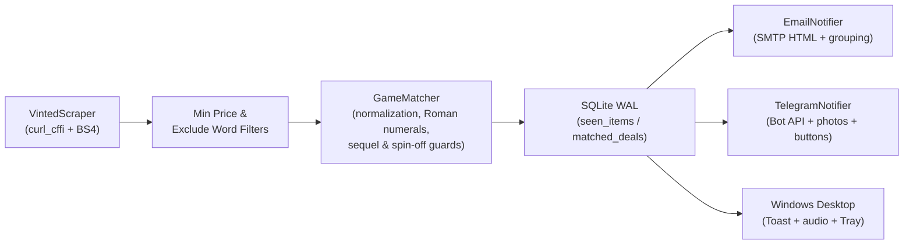
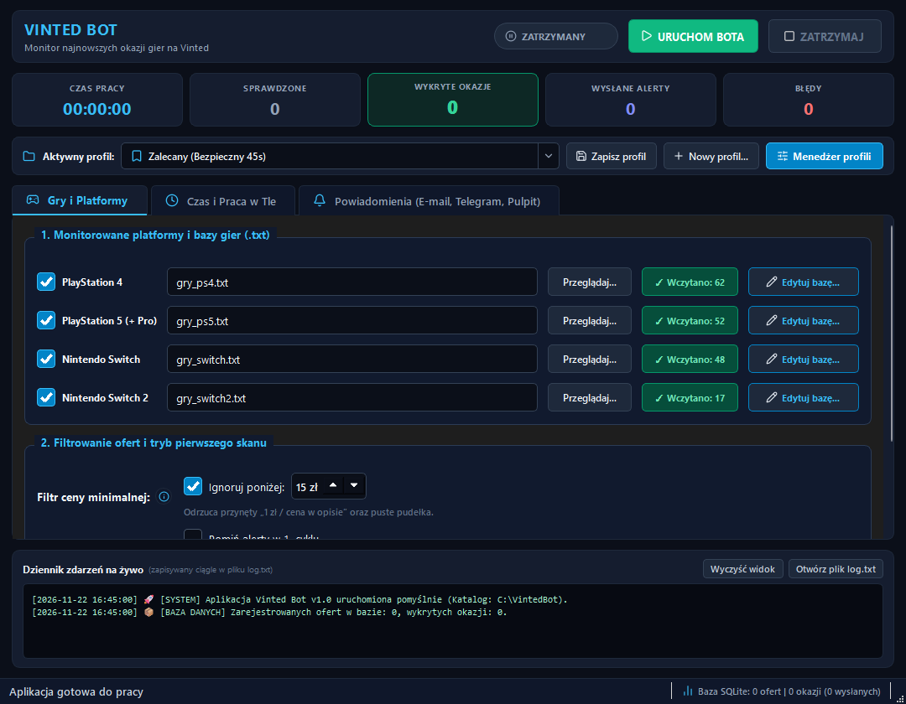
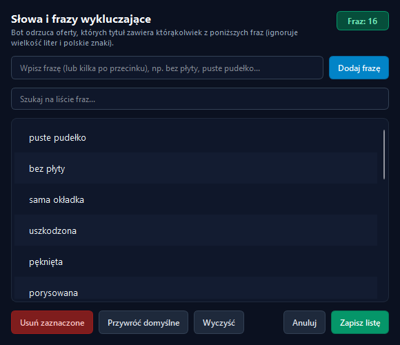
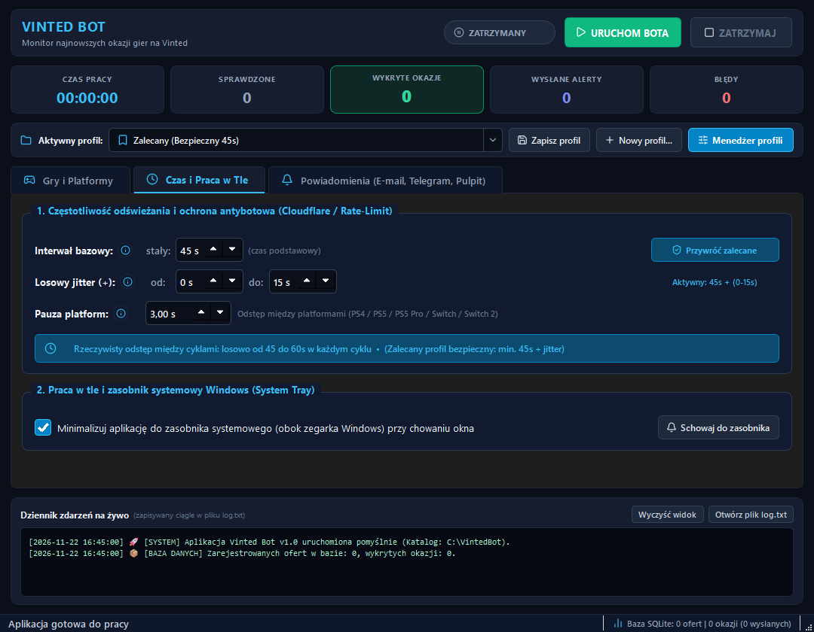
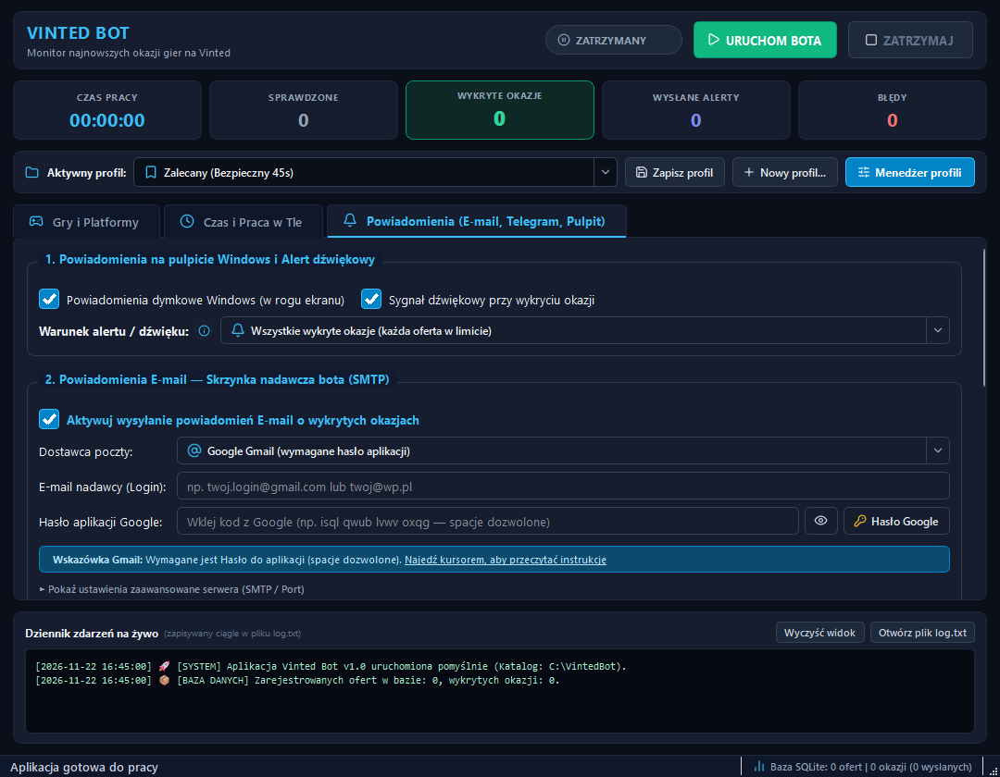

[English](#vinted-bot-game-deals-monitor-case-study) | [Polski](#wersja-polska)

---

# Vinted Bot: Game Deals Monitor (Case Study)

> **Commercial client project.**  
> Because copyright was transferred to the client, the application source code remains private. This repository documents the architecture, engineering decisions, and UI of the delivered Windows desktop application.

A **Python (PyQt6)** desktop application that periodically monitors the newest boxed video game listings on Vinted across five platform categories (**PlayStation 4**, **PlayStation 5**, **PlayStation 5 Pro**, **Nintendo Switch**, **Nintendo Switch 2**), filters out irrelevant listings, and sends real-time deal alerts.

## Project Goals

- **Low network footprint and anti-bot resilience:** Instead of running a heavy headless browser (Playwright/Selenium), the bot fetches one HTTP page per platform per cycle (`order=newest_first`) using `curl_cffi` with browser TLS fingerprint impersonation.
- **Reliable 24/7 Windows operation:** Minimizes to the Windows System Tray, prevents system sleep while scanning (`SetThreadExecutionState`), recovers automatically from network drops or Cloudflare challenges (Auto-Recovery), and rotates log files at 5 MB.
- **Zero duplicate alerts:** Every processed listing is stored in a local **SQLite (WAL mode)** database, so restarts never trigger repeat notifications for previously seen items.

## Architecture

## Key Engineering Features

### 1. Title Matching & Filtering (`GameMatcher`)
- Case, diacritic, and punctuation normalization with Roman-to-Arabic numeral conversion (`GTA V` = `GTA 5`, `Wiedźmin III` = `Wiedźmin 3`).
- Strips common seller noise tags (`folia`, `stan idealny`, `PL`, `dubbing`, console names).
- **Sequel and spin-off guards:** Prevents false matches between numbered entries (`Spider-Man` vs `Spider-Man 2`, `Mortal Kombat 1` vs `Mortal Kombat 11`) and distinct titles (`God of War` vs `God of War Ragnarok`, `Elden Ring` vs `Elden Ring Nightreign`, `Astro Bot` vs `Astro Bot: Rescue Mission`).
- Configurable minimum price filter (blocks bait listings like "1 PLN, price in description") and a word-boundary exclude phrase manager (`puste pudełko`, `bez płyty`, `kod cyfrowy`, `sam steelbook`, `plakat`, etc.).

### 2. Four Notification Channels
- **E-mail (SMTP):** HTML alerts with listing photo, price, target limit, and savings; preset templates for Gmail (App Passwords), WP, Onet, o2, Interia, Outlook, plus custom SMTP settings.
- **Telegram Bot API:** Push alerts with photo, savings summary, and direct inline link buttons; built-in `Chat ID` auto-detection, multi-recipient and group chat support, and automatic `HTTP 429 retry_after` handling.
- **Per-game deal grouping:** Optional consolidation of multiple deals for the same title within a cycle into a single summary message across both E-mail and Telegram.
- **Windows Desktop & Audio:** System toast notifications and sound alerts with an optional "Mega Deals" threshold filter (minimum PLN or percentage discount below limit).

### 3. SQLite Persistence, Profiles & Windows Packaging
- **Game List Editor:** In-app editor for titles, price limits, and aliases (switches to read-only live view while scanning), synced with `.txt` files.
- **Configuration Profiles:** Four built-in presets plus custom user profiles saved without SMTP passwords or Telegram tokens.
- **Deal History:** Dedicated statistics window with per-platform breakdowns, last 200 deals table, UTF-8 BOM CSV export for Excel, and database compaction (`VACUUM`).
- **Desktop safeguards:** Single-instance lock via Windows Mutex, session summary logging on Windows shutdown (`commitDataRequest`), automatic `%APPDATA%` fallback when launched from protected directories like `Program Files`, and single-file `.exe` packaging (`PyInstaller`).

## Tech Stack

| Layer | Technology |
|---|---|
| Language | Python 3.14 |
| Desktop UI | PyQt6 + SVG icons |
| Networking & Parsing | `curl_cffi`, `BeautifulSoup4` |
| Database | SQLite (WAL mode) |
| Notifications | `smtplib` (STARTTLS / SSL), Telegram Bot API, Windows Toast |
| Packaging | PyInstaller (`BotVinted.exe`) |

---

# Wersja polska: Vinted Bot, Monitor Okazji Gier (Case Study)

> **Projekt komercyjny zrealizowany na zlecenie klienta.**  
> Ze względu na przekazanie majątkowych praw autorskich kod źródłowy aplikacji pozostaje prywatny. To repozytorium prezentuje architekturę, zastosowane rozwiązania techniczne oraz wygląd gotowej aplikacji desktopowej dla systemu Windows.

Aplikacja desktopowa napisana w **Pythonie (PyQt6)**, która cyklicznie monitoruje najnowsze ogłoszenia gier pudełkowych na Vinted dla pięciu kategorii platform (**PlayStation 4**, **PlayStation 5**, **PlayStation 5 Pro**, **Nintendo Switch**, **Nintendo Switch 2**), filtruje fałszywe trafienia i wysyła powiadomienia o okazjach cenowych w czasie rzeczywistym.

## Główne założenia projektu

- **Niski narzut sieciowy i ochrona przed blokadą:** zamiast ciężkiej przeglądarki (Playwright/Selenium) bot wysyła jedno zapytanie HTTP na platformę w cyklu (`order=newest_first`) z wykorzystaniem `curl_cffi` i emulacją odcisku TLS przeglądarki.
- **Praca ciągła 24/7 na Windowsie:** minimalizacja do zasobnika systemowego (System Tray), blokada uśpienia systemu na czas skanowania (`SetThreadExecutionState`), automatyczne wznawianie po błędach sieci lub blokadzie Cloudflare (Auto-Recovery) oraz rotacja plików dziennika po przekroczeniu 5 MB.
- **Brak duplikatów:** każde sprawdzone ogłoszenie trafia do lokalnej bazy **SQLite (tryb WAL)**, dzięki czemu po restarcie komputera lub aplikacji bot pamięta stare oferty i nie wysyła powtórnych powiadomień.

## Kluczowe funkcje inżynierskie

### 1. Dopasowywanie tytułów i filtrowanie (`GameMatcher`)
- Normalizacja wielkości liter, polskich znaków i interpunkcji oraz zamiana cyfr rzymskich na arabskie (`GTA V` = `GTA 5`, `Wiedźmin III` = `Wiedźmin 3`).
- Automatyczne oczyszczanie tytułów z typowych dopisków sprzedających (`stan idealny`, `folia`, `PL`, `dubbing`, nazwy konsol).
- **Ochrona części serii i spin-offów:** reguły wykluczające pomyłki między częściami serii (np. `Spider-Man` vs `Spider-Man 2`, `Mortal Kombat 1` vs `Mortal Kombat 11`) oraz osobnymi tytułami (`God of War` vs `God of War Ragnarok`, `Elden Ring` vs `Elden Ring Nightreign`, `Astro Bot` vs `Astro Bot: Rescue Mission`).
- Konfigurowalny filtr ceny minimalnej (odrzucanie ogłoszeń typu „1 zł, cena w opisie”) oraz menedżer słów wykluczających dopasowujący całe słowa (`puste pudełko`, `bez płyty`, `kod cyfrowy`, `sam steelbook`, `plakat` itp.).

### 2. Cztery kanały powiadomień
- **E-mail (SMTP):** wiadomości HTML ze zdjęciem oferty, ceną, limitem i oszczędnością; gotowe szablony dla Gmail (z obsługą Haseł do aplikacji), WP, Onet, o2, Interia, Outlook oraz trybem własnego serwera.
- **Telegram Bot API:** powiadomienia Push ze zdjęciem, wyliczoną oszczędnością i przyciskiem prowadzącym bezpośrednio do ogłoszenia; wbudowane wykrywanie `Chat ID`, obsługa wielu odbiorców oraz grup, a także automatyczna obsługa limitu zapytań (`HTTP 429 retry_after`).
- **Grupowanie ofert:** możliwość łączenia kilku ofert tej samej gry z jednego cyklu w jedną zbiorczą wiadomość (działa wspólnie dla e-maila i Telegrama).
- **Pulpit Windows i alert dźwiękowy:** dymki systemowe z opcją ograniczenia wyłącznie do tzw. „Mega Okazji” (tańszych od limitu o zadaną kwotę lub procent).

### 3. Baza SQLite, profile i gotowość produkcyjna Windows
- **Menedżer Bazy Gier:** edycja nazw, cen i aliasów gier bezpośrednio w aplikacji (z podglądem na żywo również podczas pracy bota) oraz synchronizacja z plikami `.txt`.
- **Profile konfiguracji:** 4 profile fabryczne oraz własne profile użytkownika zapisywane bez haseł SMTP i tokenów Telegrama.
- **Historia okazji:** osobne okno ze statystykami per platforma, tabelą ostatnich 200 okazji, eksportem do CSV (UTF-8 z BOM pod Excela) i kompaktowaniem bazy (`VACUUM`).
- **Zabezpieczenia desktopowe:** blokada uruchomienia drugiej instancji aplikacji (Windows Mutex), zapis podsumowania sesji przy zamykaniu systemu Windows (`commitDataRequest`), automatyczne przełączenie katalogu roboczego do `%APPDATA%` w razie uruchomienia z chronionego folderu (np. `Program Files`) oraz dystrybucja jako pojedynczy plik `.exe` (`PyInstaller`).

---

## Screenshots / Podgląd aplikacji

### Main Window: Games & Platforms / Okno główne: Gry i Platformy

### Exclude Words & Game List Editor / Słowa wykluczające i edytor bazy gier

### Timing, Anti-Bot & Background Mode / Czas skanowania i praca w tle

### Notifications (Desktop, E-mail SMTP, Telegram) / Powiadomienia

### Deal History & SQLite Stats / Historia okazji i statystyki SQLite

