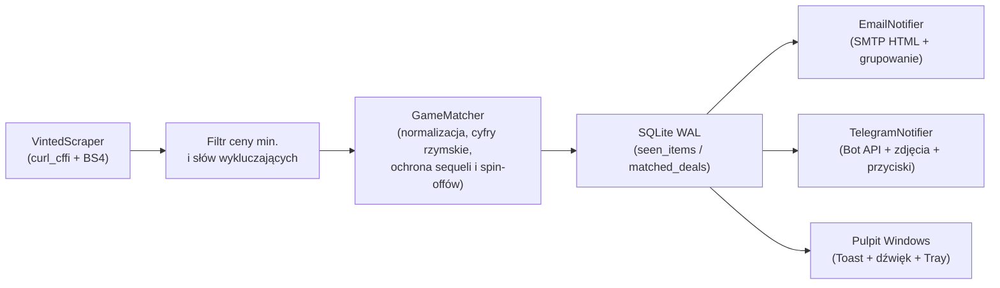
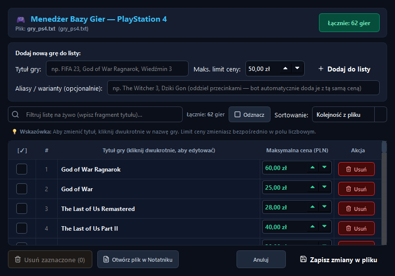
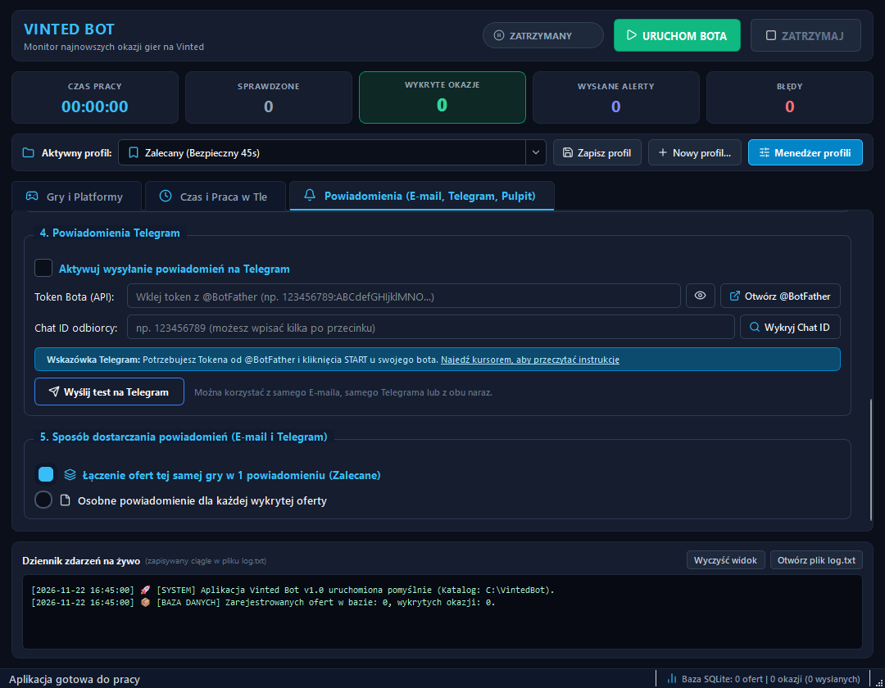
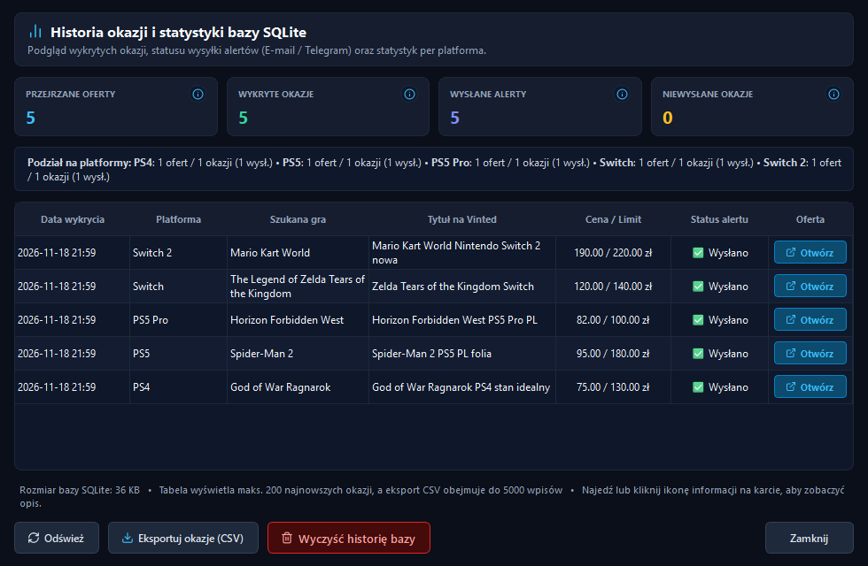

# Vinted Bot — Monitor Okazji Gier (Case Study)

> **Projekt komercyjny zrealizowany na zlecenie klienta.**  
> Ze względu na przekazanie majątkowych praw autorskich kod źródłowy aplikacji pozostaje prywatny. To repozytorium prezentuje architekturę, zastosowane rozwiązania techniczne oraz wygląd gotowej aplikacji desktopowej dla systemu Windows.

Aplikacja desktopowa napisana w **Pythonie (PyQt6)**, która cyklicznie monitoruje najnowsze ogłoszenia gier pudełkowych na Vinted dla pięciu kategorii platform (**PlayStation 4**, **PlayStation 5**, **PlayStation 5 Pro**, **Nintendo Switch**, **Nintendo Switch 2**), filtruje fałszywe trafienia i wysyła powiadomienia o okazjach cenowych w czasie rzeczywistym.

---

## Główne założenia projektu

- **Niski narzut sieciowy i ochrona przed blokadą:** zamiast ciężkiej przeglądarki (Playwright/Selenium) bot wysyła jedno zapytanie HTTP na platformę w cyklu (`order=newest_first`) z wykorzystaniem `curl_cffi` i emulacją odcisku TLS przeglądarki.
- **Praca ciągła 24/7 na Windowsie:** minimalizacja do zasobnika systemowego (System Tray), blokada uśpienia systemu na czas skanowania (`SetThreadExecutionState`), automatyczne wznawianie po błędach sieci lub blokadzie Cloudflare (Auto-Recovery) oraz rotacja plików dziennika po przekroczeniu 5 MB.
- **Brak duplikatów:** każde sprawdzone ogłoszenie trafia do lokalnej bazy **SQLite (tryb WAL)**, dzięki czemu po restarcie komputera lub aplikacji bot pamięta stare oferty i nie wysyła powtórnych powiadomień.

---

## Architektura działania

---

## Kluczowe funkcje inżynierskie

### 1. Inteligentne dopasowywanie tytułów (`GameMatcher`)
- Normalizacja wielkości liter, polskich znaków i interpunkcji oraz zamiana cyfr rzymskich na arabskie (`GTA V` = `GTA 5`, `Wiedźmin III` = `Wiedźmin 3`).
- Automatyczne oczyszczanie tytułów z typowych dopisków sprzedających (`stan idealny`, `folia`, `PL`, `dubbing`, nazwy konsol).
- **Ochrona części serii i spin-offów:** reguły wykluczające pomyłki między częściami serii (np. `Spider-Man` vs `Spider-Man 2`, `Mortal Kombat 1` vs `Mortal Kombat 11`) oraz osobnymi tytułami (`God of War` vs `God of War Ragnarok`, `Elden Ring` vs `Elden Ring Nightreign`, `Astro Bot` vs `Astro Bot: Rescue Mission`).
- Konfigurowalny filtr ceny minimalnej (odrzucanie ogłoszeń typu „1 zł, cena w opisie”) oraz menedżer słów wykluczających dopasowujący całe słowa (`puste pudełko`, `bez płyty`, `kod cyfrowy`, `sam steelbook`, `plakat` itp.).

### 2. Cztery kanały powiadomień
- **E-mail (SMTP):** wiadomości HTML ze zdjęciem oferty, ceną, limitem i oszczędnością; gotowe szablony dla Gmail (z obsługą Haseł do aplikacji), WP, Onet, o2, Interia, Outlook oraz trybem własnego serwera.
- **Telegram Bot API:** powiadomienia Push ze zdjęciem, wyliczoną oszczędnością i przyciskiem prowadzącym bezpośrednio do ogłoszenia; wbudowane wykrywanie `Chat ID`, obsługa wielu odbiorców oraz grup, a także automatyczna obsługa limitu zapytań (`HTTP 429 retry_after`).
- **Grupowanie ofert:** możliwość łączenia kilku ofert tej samej gry z jednego cyklu w jedną zbiorczą wiadomość (działa wspólnie dla e-maila i Telegrama).
- **Pulpit Windows i alert dźwiękowy:** dymki systemowe z opcją ograniczenia wyłącznie do tzw. „Mega Okazji” (tańszych od limitu o zadaną kwotę lub procent).

### 3. Baza SQLite, profile i gotowość produkcyjna Windows
- **Menedżer Bazy Gier:** edycja nazw, cen i aliasów gier bezpośrednio w aplikacji (z podglądem na żywo również podczas pracy bota) oraz synchronizacja z plikami `.txt`.
- **Profile konfiguracji:** 4 profile fabryczne oraz własne profile użytkownika zapisywane bez haseł SMTP i tokenów Telegrama.
- **Historia okazji:** osobne okno ze statystykami per platforma, tabelą ostatnich 200 okazji, eksportem do CSV (UTF-8 z BOM pod Excela) i kompaktowaniem bazy (`VACUUM`).
- **Zabezpieczenia desktopowe:** blokada uruchomienia drugiej instancji aplikacji (Windows Mutex), zapis podsumowania sesji przy zamykaniu systemu Windows (`commitDataRequest`), automatyczne przełączenie katalogu roboczego do `%APPDATA%` w razie uruchomienia z chronionego folderu (np. `Program Files`) oraz dystrybucja jako pojedynczy plik `.exe` (`PyInstaller`).

---

## Stos technologiczny

| Obszar | Technologia |
|---|---|
| Język | Python 3.14 |
| Interfejs graficzny | PyQt6 + ikony SVG |
| Sieć i parsowanie | `curl_cffi`, `BeautifulSoup4` |
| Baza danych | SQLite (tryb WAL) |
| Powiadomienia | `smtplib` (STARTTLS / SSL), Telegram Bot API, Windows Toast |
| Pakowanie | PyInstaller (`BotVinted.exe`) |

---

## Podgląd aplikacji

### Okno główne — zakładka „Gry i Platformy”

### Menedżer słów wykluczających i edytor bazy gier

### Czas skanowania, ochrona antybotowa i praca w tle

### Konfiguracja powiadomień (Pulpit, E-mail SMTP, Telegram)

### Historia wykrytych okazji i statystyki SQLite

